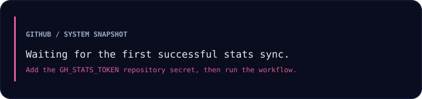
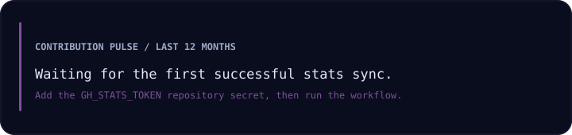
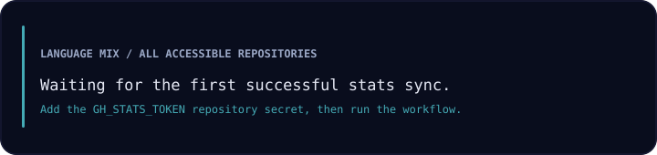
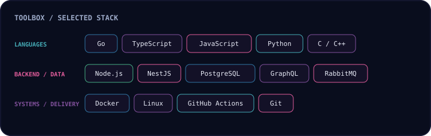
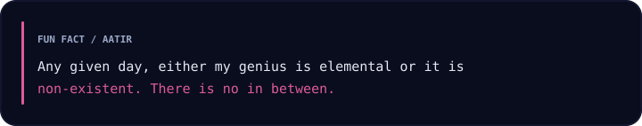
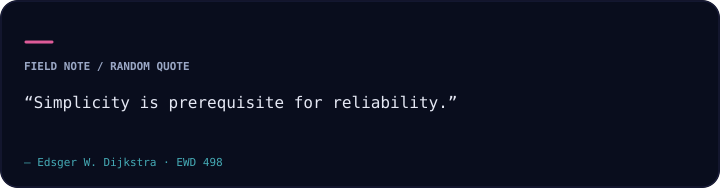

  

<h1 align="center">Aatir Nadim</h1>

  <strong>Building dependable software, useful tools, and systems that hold up in production.</strong> 
  Backend engineering · distributed systems · developer experience

  
  
  
  
  
  

---

## About

I’m a software engineer with experience taking end-to-end fintech features from idea to production, and building sales automation software as an early engineer. I enjoy work where sound system design meets practical product needs.

## Current focus

- Designing reliable services and distributed systems.
- Making engineering workflows more effective without losing sight of the people using the product.
- Exploring how AI can make software development more useful and efficient.

## Recent public projects

<!-- recent-projects:start -->
_Recent public projects will appear here after the first successful stats sync._
<!-- recent-projects:end -->

## Engineering footprint

These cards are generated from GitHub data. Repository and language totals include your owned private repositories; only aggregate values are published. Project names below are fetched from public repositories only.

  
   
  
   
  

<!-- stats-updated:start -->_Stats sync will appear here after the first successful workflow run.<!-- stats-updated:end -->

## Toolbox

  

## Fun fact

  

## A thought for the road

  

  Built with curiosity, shipped with care.

